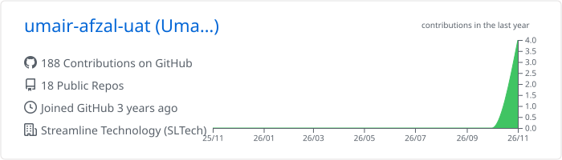
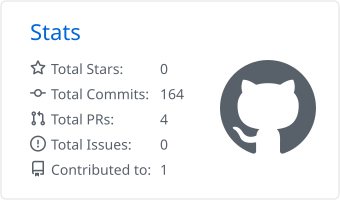
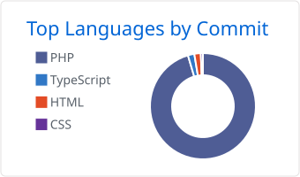

<p align="center">
  
</p>

<p align="center">
  <a href="https://umairafzal.pro/"></a>
  <a href="https://www.linkedin.com/in/mumairafzal"></a>
  <a href="mailto:umair.afzal.uat@gmail.com"></a>
</p>

<p align="center">
  
  
  
</p>

---

## 🧑‍💻 About me

Remote full-stack engineer working with **US and UK teams**. I build and lead end-to-end SaaS products: Laravel / Node.js backends, React / Next.js frontends, and production AI features on the Claude and OpenAI APIs.

```js
const umair = {
  role:        "Senior Full-Stack & AI Engineer",
  experience:  "10+ years",
  currently:   "Project Lead @ Streamline Technology (AI real estate SaaS)",
  ai:          ["Claude API", "OpenAI API", "LangChain", "LangGraph", "RAG"],
  backend:     ["Laravel", "Node.js", "Express", "GraphQL"],
  frontend:    ["React", "Next.js", "Vue.js", "TypeScript", "Tailwind"],
  openTo:      ["Senior remote roles", "Freelance", "Contract"],
};
```

## 🏆 Highlights

<table>
  <tr>
    <td align="center" width="25%"><h3>10+</h3>years building products</td>
    <td align="center" width="25%"><h3>15+</h3>engineers led</td>
    <td align="center" width="25%"><h3>2M+</h3>leads / day handled</td>
    <td align="center" width="25%"><h3>£100M+</h3>client campaign revenue</td>
  </tr>
</table>

- ⚡ Cut query response times from **4s → 1s** on an AI real estate SaaS
- 🚀 Set up infrastructure for **25+ deploys per week**
- 🧠 Reduced API latency by **~40%** with Redis caching
- 🔐 Integrated **30+ security tools** into a compliance platform

## 🏢 Experience

| Role | Company | Period |
|:--|:--|:--:|
| **Full-Stack Engineer / Project Lead** | Streamline Technology (SLTech) · US SaaS · Remote | 2024 – Present |
| **Full-Stack Engineer** | Redesign Group · Security SaaS · USA · Remote | 2023 – 2025 |
| **Lead Developer / Technical Architect** | The Genius Group · UK lead-gen SaaS · Remote | 2018 – 2024 |
| **Team Lead Software Engineer** | ArhamSoft Pvt Ltd · Lahore | 2015 – 2023 |
| **Sr Web Developer & Software Engineer** | Bir-al-Sabia Technologies & Punjab IT Board | 2013 – 2015 |

## 🚀 Featured projects

<table>
  <tr>
    <td width="50%" valign="top">
      <h4>🏠 AI Real Estate SaaS</h4>
      MLS-triggered website generation with Claude and OpenAI.<br/>
      <sub><b>Next.js · Laravel · Claude API · RAG</b></sub>
    </td>
    <td width="50%" valign="top">
      <h4>📈 Lead Generation Platform</h4>
      Multi-campaign SaaS for UK claims verticals, £100M+ campaign revenue.<br/>
      <sub><b>PHP · Laravel · React · MySQL · Twilio</b></sub>
    </td>
  </tr>
  <tr>
    <td width="50%" valign="top">
      <h4>✍️ EsignPanda & NowSign</h4>
      Enterprise e-signature SaaS.<br/>
      <sub><b>Node.js · React · MongoDB · AWS</b></sub>
    </td>
    <td width="50%" valign="top">
      <h4>🛡️ Cybersecurity Compliance</h4>
      Multi-tenant security posture platform with 30+ tool integrations.<br/>
      <sub><b>Node.js · React · PostgreSQL · Docker</b></sub>
    </td>
  </tr>
  <tr>
    <td width="50%" valign="top">
      <h4>🧱 ControlPanda</h4>
      Drag-and-drop website builder with payments.<br/>
      <sub><b>PHP · Laravel · React · PayPal</b></sub>
    </td>
    <td width="50%" valign="top">
      <h4>📮 PostCode Lookup Service</h4>
      UK postcode address API.<br/>
      <sub><b>Node.js · React · MongoDB</b></sub>
    </td>
  </tr>
</table>

<p align="center">➕ 100+ more small and medium projects on <a href="https://umairafzal.pro/"><b>umairafzal.pro</b></a></p>

## 🛠️ Tech stack

<p align="center">
  <br/>
  
</p>

<p align="center">
  
  
  
  
  
  
  
</p>

## 🎓 Education

- 🎓 **MPhil, Computer Science**, University of Sargodha (2015 – 2018)
- 🎓 **MSc, Information Technology**, University of the Punjab, PUCIT (2011 – 2013)

## 📊 GitHub stats

<p align="center">
  <picture>
    <source media="(prefers-color-scheme: dark)" srcset="./profile-summary-card-output/github_dark/0-profile-details.svg" />
    
  </picture>
</p>

<p align="center">
  <picture>
    <source media="(prefers-color-scheme: dark)" srcset="./profile-summary-card-output/github_dark/3-stats.svg" />
    
  </picture>
  <picture>
    <source media="(prefers-color-scheme: dark)" srcset="./profile-summary-card-output/github_dark/2-most-commit-language.svg" />
    
  </picture>
</p>

<p align="center">
  <picture>
    <source media="(prefers-color-scheme: dark)" srcset="https://raw.githubusercontent.com/umair-afzal-uat/umair-afzal-uat/output/github-snake-dark.svg" />
    
  </picture>
</p>

## 🤝 Let's work together

<p align="center">
  Building a SaaS, adding AI to your product, or need a senior engineer to lead delivery?<br/>
  <b>I reply within 24 hours.</b>
</p>

<p align="center">
  <a href="mailto:umair.afzal.uat@gmail.com"></a>
</p>


